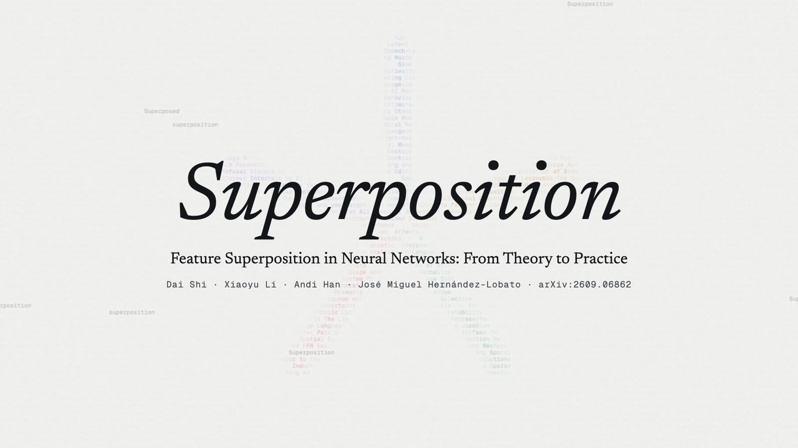

<p align="center">
  <a href="https://eethanshi.github.io/awesome-superposition/">
    <picture>
      <source media="(prefers-color-scheme: dark)" srcset="assets/banner-dark.svg">
      
    </picture>
  </a>
</p>

<p align="center">
  <a href="https://github.com/EEthanShi/awesome-superposition/actions/workflows/daily.yml"></a>
  <a href="https://eethanshi.github.io/awesome-superposition/"></a>
  <a href="#reading-list"></a>
  <a href="https://arxiv.org/abs/2609.06862"></a>
  <a href="https://www.youtube.com/watch?v=scsMqFfoiKY"></a>
  <a href="LICENSE"></a>
</p>

<p align="center">
  <b>A curated reading list on feature superposition in neural networks, from theory to practice,<br>and a feed of new arXiv papers that updates every day.</b>
</p>

<p align="center">
  <a href="https://eethanshi.github.io/awesome-superposition/"><b>Website</b></a> &nbsp;·&nbsp;
  <a href="https://www.youtube.com/watch?v=scsMqFfoiKY"><b>Film</b></a> &nbsp;·&nbsp;
  <a href="https://arxiv.org/abs/2609.06862"><b>Survey</b></a> &nbsp;·&nbsp;
  <a href="#reading-list"><b>Reading list</b></a> &nbsp;·&nbsp;
  <a href="#new-papers-updated-daily"><b>New papers</b></a> &nbsp;·&nbsp;
  <a href="https://eethanshi.github.io/awesome-superposition/feed.xml"><b>RSS</b></a>
</p>

Superposition refers to neural networks representing more features than they have dimensions.
The reading list follows the survey
[Feature Superposition in Neural Networks: From Theory to Practice](https://arxiv.org/abs/2609.06862):
first the theory (geometry, when training produces superposition, reading features back, and
computation), then the practice (recovery methods, their evaluation, failure modes, and
applications). Each entry has one sentence on what the work shows.

<table>
  <tr>
    <td width="50%" valign="top">
      <a href="https://www.youtube.com/watch?v=scsMqFfoiKY"></a>
      <p><b>Watch the survey in eight minutes.</b> From five features in two dimensions to what sparse autoencoders can and cannot establish, one level of claim at a time. <a href="https://www.youtube.com/watch?v=scsMqFfoiKY">YouTube&nbsp;→</a></p>
      <details>
        <summary>Chapters</summary>
        <p><a href="https://www.youtube.com/watch?v=scsMqFfoiKY&t=0s">0:00&nbsp;Overture</a> · <a href="https://www.youtube.com/watch?v=scsMqFfoiKY&t=38s">0:38&nbsp;Geometry</a> · <a href="https://www.youtube.com/watch?v=scsMqFfoiKY&t=113s">1:53&nbsp;Sparsity</a> · <a href="https://www.youtube.com/watch?v=scsMqFfoiKY&t=165s">2:45&nbsp;Computation</a> · <a href="https://www.youtube.com/watch?v=scsMqFfoiKY&t=238s">3:58&nbsp;Practice</a> · <a href="https://www.youtube.com/watch?v=scsMqFfoiKY&t=338s">5:38&nbsp;Failure modes</a> · <a href="https://www.youtube.com/watch?v=scsMqFfoiKY&t=418s">6:58&nbsp;Open questions</a> · <a href="https://www.youtube.com/watch?v=scsMqFfoiKY&t=452s">7:32&nbsp;Coda</a></p>
      </details>
    </td>
    <td width="50%" valign="top">
      <a href="https://eethanshi.github.io/awesome-superposition/"></a>
      <p><b>Train the toy model in your browser.</b> Drag the density slider and watch five features go from two orthogonal directions, to antipodal pairs, to a pentagon. <a href="https://eethanshi.github.io/awesome-superposition/">Open the website&nbsp;→</a></p>
    </td>
  </tr>
</table>

## Reading list

<!-- LIST:START -->
| Part | Sections |
|:--|:--|
| **Start** | [Start here](#start-here) <sub>7</sub> |
| **Theory** | [Definitions and geometry](#definitions-and-geometry) <sub>8</sub> · [When training produces superposition](#when-training-produces-superposition) <sub>5</sub> · [Reading features back](#reading-features-back) <sub>6</sub> · [Computation in superposition](#computation-in-superposition) <sub>6</sub> · [Superposition as an explanation](#superposition-as-an-explanation) <sub>6</sub> |
| **Practice** | [Supervised probes](#supervised-probes) <sub>2</sub> · [Sparse autoencoders](#sparse-autoencoders) <sub>10</sub> · [Transcoders, crosscoders, and circuits](#transcoders-crosscoders-and-circuits) <sub>7</sub> · [Parameter decomposition](#parameter-decomposition) <sub>4</sub> · [Evaluation and benchmarks](#evaluation-and-benchmarks) <sub>10</sub> · [Failure modes](#failure-modes) <sub>9</sub> · [Applications and other domains](#applications-and-other-domains) <sub>10</sub> |
| **New** | [Recent, not yet covered by the survey](#recent-not-yet-covered-by-the-survey) <sub>7</sub> |

### Start here

*Reviews and the reports that set up the field.*

- **[Toy Models of Superposition](https://transformer-circuits.pub/2022/toy_model/index.html)** <sub>Elhage et al. · 2022 · Transformer Circuits</sub><br>Small ReLU networks trained on sparse synthetic features keep more useful features than they have hidden dimensions; the reference point for the field.
- **[Feature Superposition in Neural Networks: From Theory to Practice](https://arxiv.org/abs/2609.06862)** <sub>Shi, Li, Han, and Hernández-Lobato · 2026 · preprint</sub><br>Survey that organizes the theory by the class of decoder allowed to read features back, and the practice by the strength of the claims each result supports.
- **[Open Problems in Mechanistic Interpretability](https://arxiv.org/abs/2501.16496)** <sub>Sharkey et al. · 2025 · TMLR</sub><br>Open problems in mechanistic interpretability, covering methods and applications, including the limits of sparse dictionary learning.
- **[A unifying framework from neural superposition to sparse interpretable codes](https://doi.org/10.1038/s42256-026-01259-z)** <sub>Klindt et al. · 2026 · Nature Machine Intelligence</sub><br>Connects superposition to identifiability theory, sparse coding through compressed sensing, and quantitative interpretability metrics.
- **[Mechanistic Interpretability for AI Safety: A Review](https://arxiv.org/abs/2404.14082)** <sub>Bereska and Gavves · 2024 · TMLR</sub><br>Review of mechanistic interpretability methods for explaining internal representations and computations.
- **[A Survey on Sparse Autoencoders: Interpreting the Internal Mechanisms of Large Language Models](https://doi.org/10.18653/v1/2025.findings-emnlp.89)** <sub>Shu et al. · 2025 · Findings of EMNLP</sub><br>Survey of sparse autoencoders: architectures, training, feature explanations, evaluation, and applications.
- **[Toward Transparent AI: A Survey on Interpreting the Inner Structures of Deep Neural Networks](https://arxiv.org/abs/2207.13243)** <sub>Räuker et al. · 2023 · preprint</sub><br>Survey of methods for interpreting the inner structures of deep networks.

<sub>[↑ contents](#reading-list)</sub>

### Definitions and geometry

*What superposition is, and how much overlap a given width forces.*

- **[From Data Statistics to Feature Geometry: How Correlations Shape Superposition](https://arxiv.org/abs/2603.09972)** <sub>Prieto et al. · 2026 · ICLR</sub><br>Defines superposition by overlapping directions plus recoverability, and shows that correlated features can be placed so that their interference helps rather than hurts.
- **[The Linear Representation Hypothesis and the Geometry of Large Language Models](https://arxiv.org/abs/2311.03658)** <sub>Park et al. · 2024 · ICML</sub><br>The linear representation hypothesis: a concept is carried by a direction and its intensity by the coefficient along that direction.
- **[Lower Bounds on the Maximum Cross Correlation of Signals](https://doi.org/10.1109/TIT.1974.1055219)** <sub>Welch · 1974 · IEEE Trans. Inf. Theory</sub><br>The Welch bound: more unit vectors than dimensions force a minimum worst-case overlap.
- **[Finite Normalized Tight Frames](https://doi.org/10.1023/A:1021323312367)** <sub>Benedetto and Fickus · 2003 · Adv. Comput. Math.</sub><br>Tight frames, which attain the lower bound on the total squared overlap of unit vectors.
- **[Extensions of Lipschitz mappings into a Hilbert space](https://doi.org/10.1090/conm/026/737400)** <sub>Johnson and Lindenstrauss · 1984 · Contemp. Math.</sub><br>The Johnson-Lindenstrauss lemma: exponentially many nearly orthogonal directions fit in a given dimension.
- **[Optimally sparse representation in general (nonorthogonal) dictionaries via ℓ¹ minimization](https://doi.org/10.1073/pnas.0437847100)** <sub>Donoho and Elad · 2003 · PNAS</sub><br>Exact sparse recovery from overcomplete dictionaries, the compressed-sensing side of superposition.
- **[Emergence of simple-cell receptive field properties by learning a sparse code for natural images](https://doi.org/10.1038/381607a0)** <sub>Olshausen and Field · 1996 · Nature</sub><br>Sparse coding of natural images, the origin of dictionary learning.
- **[Linear Algebraic Structure of Word Senses, with Applications to Polysemy](https://arxiv.org/abs/1601.03764)** <sub>Arora et al. · 2018 · TACL</sub><br>Proves that a polysemous word embedding is approximately a frequency-weighted sum of sense vectors, which sparse coding recovers.

<sub>[↑ contents](#reading-list)</sub>

### When training produces superposition

*Conditions under which trained models share dimensions among features.*

- **[Polysemanticity and Capacity in Neural Networks](https://arxiv.org/abs/2210.01892)** <sub>Scherlis et al. · 2022 · preprint</sub><br>Defines feature capacity and shows that the loss-minimizing allocation shares dimensions among features of intermediate importance once feature values are heavier-tailed than a Gaussian.
- **[What Causes Polysemanticity? An Alternative Origin Story of Mixed Selectivity from Incidental Causes](https://arxiv.org/abs/2312.03096)** <sub>Lecomte et al. · 2024 · preprint</sub><br>Incidental polysemanticity: networks with at least as many neurons as features can still become polysemantic.
- **[Superposition Yields Robust Neural Scaling](https://arxiv.org/abs/2505.10465)** <sub>Liu et al. · 2025 · NeurIPS</sub><br>Argues that loss falls as one over width in a strong-superposition regime, and relates this to loss-width fits on open language models.
- **[Superposition Unifies Power-Law Training Dynamics](https://arxiv.org/abs/2602.01045)** <sub>Chen et al. · 2026 · preprint</sub><br>Derives power-law training dynamics from a superposition bottleneck in a teacher-student model.
- **[Expand Neurons, Not Parameters](https://arxiv.org/abs/2510.04500)** <sub>Kong et al. · 2026 · ICML</sub><br>Splitting neurons into sparser sub-neurons at a fixed nonzero parameter count improves performance, attributed to fewer feature collisions.

<sub>[↑ contents](#reading-list)</sub>

### Reading features back

*How wide a layer must be for its features to be recovered, and by which decoder.*

- **[How Many Features Can a Language Model Store Under the Linear Representation Hypothesis?](https://arxiv.org/abs/2602.11246)** <sub>Garg et al. · 2026 · preprint</sub><br>One fixed linear map that reads back every k-sparse pattern needs a width of order k squared, up to logarithmic factors.
- **[Stable signal recovery from incomplete and inaccurate measurements](https://arxiv.org/abs/math/0503066)** <sub>Candès et al. · 2006 · Comm. Pure Appl. Math.</sub><br>Sparse optimization recovers every k-sparse signal from about k log(d/k) measurements under restricted isometry.
- **[Taming Polysemanticity in LLMs: Provable Feature Recovery via Sparse Autoencoders](https://arxiv.org/abs/2506.14002)** <sub>Chen et al. · 2025 · preprint</sub><br>Feature-recovery guarantees for a sparse autoencoder variant under a generative model of activations.
- **[Provably Extracting the Features from a General Superposition](https://arxiv.org/abs/2512.15987)** <sub>Liu · 2026 · preprint</sub><br>Recovers the directions of a sum of ridge functions from noisy queries, under nondegeneracy conditions.
- **[On the Limits of Sparse Autoencoders: A Theoretical Framework and Reweighted Remedy](https://arxiv.org/abs/2506.15963)** <sub>Cui et al. · 2025 · preprint</sub><br>Closed-form sparse autoencoder optima recover the true features only under stringent sparsity conditions.
- **[A Unified Theory of Sparse Dictionary Learning in Mechanistic Interpretability: Piecewise Biconvexity and Spurious Minima](https://arxiv.org/abs/2512.05534)** <sub>Tang et al. · 2026 · preprint</sub><br>Casts SAE, transcoder, and crosscoder objectives as one piecewise biconvex problem; absorption and dead latents follow from the geometry of its solutions.

<sub>[↑ contents](#reading-list)</sub>

### Computation in superposition

*What a network can compute without first decompressing its features.*

- **[On the Complexity of Neural Computation in Superposition](https://arxiv.org/abs/2409.15318)** <sub>Adler and Shavit · 2024 · preprint</sub><br>Storing sparse Boolean features takes logarithmic width, while computing a whole family of such functions needs more width than storing their outputs.
- **[Mathematical Models of Computation in Superposition](https://arxiv.org/abs/2408.05451)** <sub>Hänni et al. · 2024 · workshop</sub><br>Constructions that compute all pairwise ANDs of sparse features in superposition; even random networks make many such functions linearly readable.
- **[Towards Combinatorial Interpretability of Neural Computation](https://arxiv.org/abs/2504.08842)** <sub>Adler et al. · 2025 · preprint</sub><br>Reads output-channel routing motifs off the weight signs of two-layer MLPs trained on sparse Boolean formulas.
- **[Compressed Computation is (probably) not Computation in Superposition](https://arxiv.org/abs/2606.14673)** <sub>Bhagat et al. · 2026 · workshop</sub><br>Shows that a reported loss advantage for compressed computation comes from a linear mixing term created by the residual and the embedding.
- **[Compressed Computation under L⁴ Loss is likely Computation in Superposition](https://arxiv.org/abs/2607.04800)** <sub>Ferreira da Silva and Heimersheim · 2026 · preprint</sub><br>Removes the residual and trains under a fourth-power loss, which yields a sparse code consistent with computation in superposition.
- **[Temporal Superposition and Feature Geometry of RNNs under Memory Demands](https://openreview.net/forum?id=7cMzTpbJHC)** <sub>Sharma et al. · 2026 · ICLR</sub><br>Superposition across time in recurrent networks, with an exact loss decomposition into projection and composition interference.

<sub>[↑ contents](#reading-list)</sub>

### Superposition as an explanation

*Phenomena that superposition has been proposed to explain.*

- **[Adversarial Examples Are Not Bugs, They Are Superposition](https://arxiv.org/abs/2508.17456)** <sub>Gorton and Lewis · 2025 · preprint</sub><br>Argues that superposition may be a primary cause of adversarial examples.
- **[Adversarial Attacks Leverage Interference Between Features in Superposition](https://arxiv.org/abs/2510.11709)** <sub>Stevinson et al. · 2026 · ICML</sub><br>Proves that optimal perturbations in a linear bottleneck follow the interference between readout directions.
- **[Superposition as Lossy Compression: Measure with Sparse Autoencoders and Connect to Adversarial Vulnerability](https://arxiv.org/abs/2512.13568)** <sub>Bereska et al. · 2025 · TMLR</sub><br>Counts effective features per neuron with an entropy measure built on sparse autoencoders, and relates the count to adversarial training.
- **[Similarity of Neural Network Representations in Superposition](https://arxiv.org/abs/2604.00208)** <sub>Liu et al. · 2026 · preprint</sub><br>How RSA, linear CKA, and linear regression behave on representations in superposition.
- **[The importance of mixed selectivity in complex cognitive tasks](https://doi.org/10.1038/nature12160)** <sub>Rigotti et al. · 2013 · Nature</sub><br>Neuroscience: nonlinear mixed selectivity raises the dimension of neural activity and supports linear classification.
- **[Neural Population Coding of Multiple Stimuli](https://arxiv.org/abs/1410.1093)** <sub>Orhan and Ma · 2015 · J. Neurosci.</sub><br>Neuroscience: decoding several stimuli from one neural population with unbiased and optimal linear estimators.

<sub>[↑ contents](#reading-list)</sub>

### Supervised probes

*Reading a property named in advance from the activations.*

- **[Finding Neurons in a Haystack: Case Studies with Sparse Probing](https://arxiv.org/abs/2305.01610)** <sub>Gurnee et al. · 2023 · TMLR</sub><br>Sparse probing: restricts a probe to a few neurons to test whether a property is localized in the neuron basis.
- **[Towards Principled Evaluations of Sparse Autoencoders for Interpretability and Control](https://arxiv.org/abs/2405.08366)** <sub>Makelov et al. · 2025 · ICLR</sub><br>Supervised dictionaries built from class-conditional means, used as a reference against which sparse autoencoders are tested causally.

<sub>[↑ contents](#reading-list)</sub>

### Sparse autoencoders

*Unsupervised dictionaries that estimate features from activations.*

- **[Towards Monosemanticity: Decomposing Language Models With Dictionary Learning](https://transformer-circuits.pub/2023/monosemantic-features/index.html)** <sub>Bricken et al. · 2023 · Transformer Circuits</sub><br>Dictionary learning on a one-layer transformer, decomposing polysemantic neurons into sparse latents.
- **[Sparse Autoencoders Find Highly Interpretable Features in Language Models](https://arxiv.org/abs/2309.08600)** <sub>Cunningham et al. · 2024 · ICLR</sub><br>Trains sparse autoencoders on language-model activations to find interpretable directions.
- **[Scaling Monosemanticity: Extracting Interpretable Features from Claude 3 Sonnet](https://arxiv.org/abs/2605.29358)** <sub>Templeton et al. · 2024 · Transformer Circuits</sub><br>Scales sparse autoencoders to a production model, with up to 34 million latents on Claude 3 Sonnet.
- **[Scaling and Evaluating Sparse Autoencoders](https://arxiv.org/abs/2406.04093)** <sub>Gao et al. · 2025 · ICLR</sub><br>TopK sparse autoencoders with an auxiliary loss against dead latents, scaled to 16 million latents on GPT-4 activations.
- **[Improving Dictionary Learning with Gated Sparse Autoencoders](https://arxiv.org/abs/2404.16014)** <sub>Rajamanoharan et al. · 2024 · NeurIPS</sub><br>Separates which latents fire from how large they are, removing the shrinkage caused by the L1 penalty.
- **[Jumping Ahead: Improving Reconstruction Fidelity with JumpReLU Sparse Autoencoders](https://arxiv.org/abs/2407.14435)** <sub>Rajamanoharan et al. · 2024 · preprint</sub><br>Per-latent thresholds that allow variable activity without coupling latents to each other.
- **[BatchTopK Sparse Autoencoders](https://arxiv.org/abs/2412.06410)** <sub>Bussmann et al. · 2024 · preprint</sub><br>Selects the active latents per batch instead of per example.
- **[Learning Multi-Level Features with Matryoshka Sparse Autoencoders](https://arxiv.org/abs/2503.17547)** <sub>Bussmann et al. · 2025 · ICML</sub><br>Nested dictionaries that change how related properties share latents, reducing absorption as width grows.
- **[Identifying Functionally Important Features with End-to-End Sparse Dictionary Learning](https://arxiv.org/abs/2405.12241)** <sub>Braun et al. · 2024 · NeurIPS</sub><br>Trains the dictionary on the model's downstream loss instead of activation reconstruction.
- **[Gemma Scope: Open Sparse Autoencoders Everywhere All at Once on Gemma 2](https://arxiv.org/abs/2408.05147)** <sub>Lieberum et al. · 2024 · technical report</sub><br>More than 400 open sparse autoencoders across every layer of Gemma 2 2B and 9B, plus selected layers of 27B.

<sub>[↑ contents](#reading-list)</sub>

### Transcoders, crosscoders, and circuits

*Interpretable stand-ins for parts of the network's computation.*

- **[Transcoders Find Interpretable LLM Feature Circuits](https://arxiv.org/abs/2406.11944)** <sub>Dunefsky et al. · 2024 · NeurIPS</sub><br>Replaces MLPs with sparse transcoders, so that latent-to-latent attributions factorize through the weights.
- **[Sparse Feature Circuits: Discovering and Editing Interpretable Causal Graphs in Language Models](https://arxiv.org/abs/2403.19647)** <sub>Marks et al. · 2025 · ICLR</sub><br>Builds circuits from sparse autoencoder latents with error nodes, and edits model behavior through them.
- **[Sparse Crosscoders for Cross-Layer Features and Model Diffing](https://transformer-circuits.pub/2024/crosscoders/index.html)** <sub>Lindsey et al. · 2024 · Transformer Circuits</sub><br>Latents that read from and write to several layers, also used to compare two models.
- **[Circuit Tracing: Revealing Computational Graphs in Language Models](https://transformer-circuits.pub/2025/attribution-graphs/methods.html)** <sub>Ameisen et al. · 2025 · Transformer Circuits</sub><br>Cross-layer transcoders and attribution graphs for tracing a model's computation on a prompt.
- **[On the Biology of a Large Language Model](https://transformer-circuits.pub/2025/attribution-graphs/biology.html)** <sub>Lindsey et al. · 2025 · Transformer Circuits</sub><br>Attribution graphs applied to many behaviors of Claude 3.5 Haiku; the authors report insight on about a quarter of the prompts they tried.
- **[Sparse Mixtures of Linear Transforms](https://transformer-circuits.pub/2025/bulk-update/index.html)** <sub>Lindsey et al. · 2025 · Transformer Circuits</sub><br>Replacement layers built from sparse mixtures of linear transforms.
- **[Insights on Crosscoder Model Diffing](https://transformer-circuits.pub/2025/crosscoder-diffing-update/index.html)** <sub>Mishra-Sharma et al. · 2025 · Transformer Circuits</sub><br>How the crosscoder objective decides which latents are exclusive to one of two models.

<sub>[↑ contents](#reading-list)</sub>

### Parameter decomposition

*Decomposing the trained weights into mechanisms.*

- **[A Toy Model of Interference Weights](https://transformer-circuits.pub/2025/interference-weights/index.html)** <sub>Olah et al. · 2025 · Transformer Circuits</sub><br>Argues that superposition contaminates the weights between features, motivating decomposition in parameter space.
- **[Interpretability in Parameter Space: Minimizing Mechanistic Description Length with Attribution-based Parameter Decomposition](https://arxiv.org/abs/2501.14926)** <sub>Braun et al. · 2025 · preprint</sub><br>Decomposes weights into mechanisms by minimizing description length; recovers ground-truth mechanisms in toy models.
- **[Stochastic Parameter Decomposition](https://arxiv.org/abs/2506.20790)** <sub>Bushnaq et al. · 2025 · preprint</sub><br>A stochastic, more scalable form of parameter decomposition.
- **[Interpreting Language Model Parameters](https://arxiv.org/abs/2610.20748)** <sub>Bushnaq et al. · 2026 · research report</sub><br>Extends parameter decomposition to language models and tests components with adversarially chosen ablations.

<sub>[↑ contents](#reading-list)</sub>

### Evaluation and benchmarks

*How recovered features are checked when the true features are unknown.*

- **[Measuring Progress in Dictionary Learning for Language Model Interpretability with Board Game Models](https://arxiv.org/abs/2408.00113)** <sub>Karvonen et al. · 2024 · NeurIPS</sub><br>Chess and Othello models with known board properties as a test of dictionary recovery.
- **[SAEBench: A Comprehensive Benchmark for Sparse Autoencoders in Language Model Interpretability](https://arxiv.org/abs/2503.09532)** <sub>Karvonen et al. · 2025 · ICML</sub><br>A benchmark across more than 200 dictionaries, seven architectures, and several metrics.
- **[SynthSAEBench: Evaluating Sparse Autoencoders on Scalable Realistic Synthetic Data](https://arxiv.org/abs/2602.14687)** <sub>Chanin and Garriga-Alonso · 2026 · ICML</sub><br>Synthetic activations with hierarchy, correlations, and Zipfian firing, so recovered features can be checked against the truth.
- **[Are Sparse Autoencoder Benchmarks Reliable?](https://arxiv.org/abs/2605.18229)** <sub>Chanin · 2026 · preprint</sub><br>Finds score differences between similar dictionaries within their own seed-to-seed variation.
- **[Sanity Checks for Sparse Autoencoders: Do SAEs Beat Random Baselines?](https://arxiv.org/abs/2602.14111)** <sub>Korznikov et al. · 2026 · NeurIPS</sub><br>Sparse autoencoders with directions kept at or near random initialization score close to trained ones on several evaluations.
- **[Sparse but Wrong: Incorrect L₀ Leads to Incorrect Features in Sparse Autoencoders](https://arxiv.org/abs/2508.16560)** <sub>Chanin and Garriga-Alonso · 2026 · ICML</sub><br>Too low an L0 mixes correlated features, and too high an L0 admits degenerate mixtures.
- **[Are Sparse Autoencoders Useful? A Case Study in Sparse Probing](https://arxiv.org/abs/2502.16681)** <sub>Kantamneni et al. · 2025 · ICML</sub><br>Sparse-autoencoder probes against baselines under data scarcity, class imbalance, label noise, and covariate shift.
- **[Decomposing the Dark Matter of Sparse Autoencoders](https://arxiv.org/abs/2410.14670)** <sub>Engels et al. · 2025 · TMLR</sub><br>Models activations as sparse features plus a dense component, and studies the error that sparse autoencoders leave.
- **[AxBench: Steering LLMs? Even Simple Baselines Outperform Sparse Autoencoders](https://arxiv.org/abs/2501.17148)** <sub>Wu et al. · 2025 · ICML</sub><br>Steering and concept detection across 500 concepts; dictionary methods are not competitive with simple baselines in its settings.
- **[From Geometric Recovery to Causal Validation: A Reproducible Audit of Sparse Autoencoder Features](https://arxiv.org/abs/2607.12166)** <sub>Bal · 2026 · preprint</sub><br>Ablates and steers recovered features in a synthetic setting to test whether they are causal.

<sub>[↑ contents](#reading-list)</sub>

### Failure modes

*Where recovered features differ from the network's features.*

- **[A is for Absorption: Studying Feature Splitting and Absorption in Sparse Autoencoders](https://arxiv.org/abs/2409.14507)** <sub>Chanin et al. · 2025 · NeurIPS</sub><br>Feature splitting and absorption: a specific latent takes over a general one when a child feature implies its parent.
- **[Feature Hedging: Correlated Features Break Narrow Sparse Autoencoders](https://arxiv.org/abs/2505.11756)** <sub>Chanin et al. · 2025 · preprint</sub><br>Dictionaries narrower than the feature set merge correlated features into one latent.
- **[Sparse Autoencoders Do Not Find Canonical Units of Analysis](https://arxiv.org/abs/2502.04878)** <sub>Leask et al. · 2025 · ICLR</sub><br>Latents at one dictionary width decompose into latents at another, so they are not canonical units.
- **[Not All Language Model Features Are One-Dimensionally Linear](https://arxiv.org/abs/2405.14860)** <sub>Engels et al. · 2025 · ICLR</sub><br>Days, months, and years lie on circles in two-dimensional subspaces.
- **[When Models Manipulate Manifolds: The Geometry of a Counting Task](https://transformer-circuits.pub/2025/linebreaks/index.html)** <sub>Gurnee et al. · 2026 · Transformer Circuits</sub><br>A counting task represented on a curved manifold that dictionary latents discretize.
- **[Do Sparse Autoencoders Capture Concept Manifolds?](https://arxiv.org/abs/2604.28119)** <sub>Bhalla et al. · 2026 · preprint</sub><br>Separates capturing a concept manifold with a few latents from shattering or diluting it.
- **[An Interpretability Illusion for BERT](https://arxiv.org/abs/2104.07143)** <sub>Bolukbasi et al. · 2021 · preprint</sub><br>Random directions show coherent top-activating examples about as often as neurons do.
- **[Unstable Features, Reproducible Subspaces: Understanding Seed Dependence in Sparse Autoencoders](https://arxiv.org/abs/2606.12138)** <sub>Gerasimov et al. · 2026 · preprint</sub><br>Estimates how likely a latent is to reappear in an independent training run.
- **[Ablating Archetypes: The Stability of Archetypal SAEs is an Artifact of Initialization and Metric Design](https://arxiv.org/abs/2606.02061)** <sub>Brzozowski and Chung · 2026 · preprint</sub><br>Separates stable endpoints from convergence across independent runs for archetypal sparse autoencoders.

<sub>[↑ contents](#reading-list)</sub>

### Applications and other domains

*Steering, editing, and models beyond language.*

- **[Steering LLMs? Actually, Sparse Autoencoders Can Outperform Simple Baselines](https://arxiv.org/abs/2605.31183)** <sub>Jørgensen and Hansen · 2026 · preprint</sub><br>With supervised labeling and selection, sparse-autoencoder steering approaches a LoRA reference while staying below prompting.
- **[Look But Don't Touch with Sparse Autoencoders for Unlearning in Diffusion Models](https://arxiv.org/abs/2606.31699)** <sub>Cassano et al. · 2026 · preprint</sub><br>Autoencoder-based concept erasure in diffusion models localizes the concept but often produces image artifacts.
- **[Understanding Emergent Misalignment via Feature Superposition Geometry](https://arxiv.org/abs/2605.00842)** <sub>Minegishi et al. · 2026 · preprint</sub><br>Explains emergent misalignment by amplification of a target feature also amplifying overlapping directions.
- **[Verbalizable Representations Form a Global Workspace in Language Models](https://arxiv.org/abs/2607.15495)** <sub>Gurnee et al. · 2026 · Transformer Circuits</sub><br>Directions built from the model's sensitivity to its activations; a small share of a concept vector's variance carries much of its output effect.
- **[Structuring Sparsity: Block-Sparse Featurizers Capture Visual Concept Manifolds](https://arxiv.org/abs/2606.25234)** <sub>Fel et al. · 2026 · preprint</sub><br>Vision concepts recovered as low-dimensional blocks rather than single directions, with generation steered within a block.
- **[Superposition in Graph Neural Networks](https://arxiv.org/abs/2509.00928)** <sub>Pertl et al. · 2025 · workshop</sub><br>Measures superposition in message-passing networks on synthetic graph tasks.
- **[Sparse Autoencoders Reveal Organized Biological Knowledge but Minimal Regulatory Logic in Single-Cell Foundation Models](https://arxiv.org/abs/2603.02952)** <sub>Kendiukhov · 2026 · preprint</sub><br>In a single-cell foundation model, only 3 of 48 transcription factors show target-specific latent responses under perturbation.
- **[Mechanistic Interpretability of EEG Foundation Models via Sparse Autoencoders](https://arxiv.org/abs/2605.13930)** <sub>Lehn-Schiøler et al. · 2026 · NeurIPS</sub><br>Ranks dictionary latents by alignment with clinical concept directions in EEG foundation models.
- **[Sparse Probes and Murky Physics: A Case Study of Interpretability Challenges in a Foundation Model for Continuum Dynamics](https://arxiv.org/abs/2606.11657)** <sub>Rosenfeld and Sonnewald · 2026 · workshop</sub><br>Recovered features in a fluid-dynamics emulator do not align with standard physical decompositions.
- **[Superposition Is Not Necessary: A Mechanistic Interpretability Analysis of Transformer Representations for Time Series Forecasting](https://arxiv.org/abs/2605.05151)** <sub>Yildirim · 2026 · preprint</sub><br>In a time-series forecaster, competitive forecasting does not require superposition.

<sub>[↑ contents](#reading-list)</sub>

### Recent, not yet covered by the survey

*Selected papers from July to October 2026.*

- **[High-probability guarantees for linear accessibility in feature superposition](https://arxiv.org/abs/2609.09556)** <sub>Vompa · 2026 · preprint</sub><br>For a fixed support with subgaussian noise, a linear readout needs a width of only about k log d with high probability.
- **[Towards a mathematical theory of superposition](https://arxiv.org/abs/2608.27540)** <sub>Ivanitskiy et al. · 2026 · preprint</sub><br>Recovery theorems for the tied readout ReLU(WᵀWx + b), built on frame theory and compressed sensing.
- **[Emergent phases of superposition: from partial to full representation](https://arxiv.org/abs/2609.36455)** <sub>Guo et al. · 2026 · preprint</sub><br>Width drives a transition from representing a subset of the features to representing all of them.
- **[The Ball and the Box: Two Geometries of Computation in Superposition](https://arxiv.org/abs/2610.11744)** <sub>Li et al. · 2026 · preprint</sub><br>Sharp width thresholds for Boolean gates from a single threshold layer; the threshold depends on the error criterion.
- **[Self-Confirming Superposition Traps in Reinforcement Learning](https://arxiv.org/abs/2609.32966)** <sub>Shi et al. · 2026 · preprint</sub><br>The reinforcement-learning loop can sustain a lower-return policy because optimal codes overlap features that rarely occur together.
- **[Sparse Transformer: a Controlled Testbed for Mechanistic Interpretability](https://arxiv.org/abs/2610.19907)** <sub>Korznikov et al. · 2026 · preprint</sub><br>A small language model whose sparse MLP gives a reference basis for testing recovery methods.
- **[Planning or Improvisation? Stress-Testing the Poetry Planning Site on Open Models and Open Cross-Layer Transcoders](https://arxiv.org/abs/2609.18440)** <sub>Jacopin · 2026 · preprint</sub><br>Re-runs the rhyme-planning case study on open models with open cross-layer transcoders: position specificity generalizes, the planning site does not.

<sub>[↑ contents](#reading-list)</sub>
<!-- LIST:END -->

## New papers, updated daily

<!-- DAILY:START -->
**534 papers** since 1 July 2026 · updated 2026-10-26 · [search and filter them on the website](https://eethanshi.github.io/awesome-superposition/) · [RSS](https://eethanshi.github.io/awesome-superposition/feed.xml)

| | Topics and papers |
|:--|:--|
| **Theory** | Superposition `19` · Polysemanticity `18` · Computation in superposition `4` · Feature geometry `19` |
| **Recovery methods** | Sparse autoencoders `163` · Dictionary learning `14` · Transcoders and circuits `35` · Parameter decomposition `3` · Absorption and splitting `6` |
| **Interpretability** | Steering `183` · Mechanistic interpretability `202` |

### Latest papers

| Date | Paper | Topics |
|:--|:--|:--|
| Oct&nbsp;23 | [Concept Acupuncturist: An Efficient and Precise Concept Erasure Method for Diffusion Models via Sparse Autoencoders](https://arxiv.org/abs/2610.32059) | <sub>Sparse autoencoders</sub> |
| Oct&nbsp;23 | [MI-MIDI 2: From Observation to Control with Sparse Autoencoders in Text-to-MIDI Generation](https://arxiv.org/abs/2610.32007) | <sub>Sparse autoencoders</sub> |
| Oct&nbsp;23 | ["Not" is Not Lost in Translation: A Causal Analysis of Negation Representations in Multilingual LLMs](https://arxiv.org/abs/2610.32281) | <sub>Sparse autoencoders</sub> |
| Oct&nbsp;23 | [Do VLAs Know They Will Fail? Interpretable Success and Failure Patterns in Physical AI Systems](https://arxiv.org/abs/2610.32208) | <sub>Sparse autoencoders</sub> |
| Oct&nbsp;23 | [Depth-Dependent Safety Geometry in Vision-Language Models: Layer-Wise Localization and Bidirectional Refusal Control](https://arxiv.org/abs/2610.32182) | <sub>Steering</sub> |
| Oct&nbsp;23 | [Angular Supervision for Visual Object Grounding in Autoregressive Vision-Language Models](https://arxiv.org/abs/2610.32220) | <sub>Mechanistic interpretability</sub> |
| Oct&nbsp;22 | [The Geometry of Metaphor: Probing and Steering Metaphor Representations in Large Language Models](https://arxiv.org/abs/2610.31520) | <sub>Mechanistic interpretability</sub> |
| Oct&nbsp;22 | [Same Entity, Different Script: Diagnosing Cross-Script Entity Matching Failures in Language Models](https://arxiv.org/abs/2610.31407) | <sub>Mechanistic interpretability</sub> |
| Oct&nbsp;22 | [The Geometry of Meaning in Neural Manifolds](https://arxiv.org/abs/2610.30938) | <sub>Steering</sub> |
| Oct&nbsp;22 | [Interpreting Model Reasoning through Behavioral Counterfactuals](https://arxiv.org/abs/2610.30630) | <sub>Mechanistic interpretability</sub> |
| Oct&nbsp;21 | [Rethinking SAE Evaluation: An Atomic Interpretable Unit Framework Reveals Hidden Polysemanticity and Redundancy](https://arxiv.org/abs/2610.30474) | <sub>Polysemanticity, Sparse autoencoders, Transcoders and circuits</sub> |
| Oct&nbsp;21 | [Building Auditable AI Text Detectors with Sparse Autoencoders](https://arxiv.org/abs/2610.30006) | <sub>Sparse autoencoders</sub> |
| Oct&nbsp;21 | [Forward-Only Learning for Shared-Kernel Wavelet Neural Networks without Backpropagation](https://arxiv.org/abs/2610.29697) | <sub>Parameter decomposition</sub> |
| Oct&nbsp;21 | [Mitigating Reward Hacking in Realistic Scenarios Through Representation Engineering](https://arxiv.org/abs/2610.29129) | <sub>Steering</sub> |
| Oct&nbsp;21 | [Probing and Steering for Safety-Relevant Behaviours in Large Language Models](https://arxiv.org/abs/2610.30363) | <sub>Steering</sub> |
| Oct&nbsp;20 | [The Router Already Knows](https://arxiv.org/abs/2610.27421) | <sub>Sparse autoencoders, Transcoders and circuits</sub> |
| Oct&nbsp;20 | [Are Linguistic and Arithmetic Circuits Dissociated in LLMs?](https://arxiv.org/abs/2610.27790) | <sub>Transcoders and circuits, Mechanistic interpretability</sub> |
| Oct&nbsp;20 | [Language Impairment as a Lens onto Large Language Models](https://arxiv.org/abs/2610.28992) | <sub>Steering, Mechanistic interpretability</sub> |
| Oct&nbsp;20 | [Where Do Legal Factors Live in LLMs?](https://arxiv.org/abs/2610.28799) | <sub>Sparse autoencoders</sub> |
| Oct&nbsp;20 | [Decision Sufficiency of Learned Representation Interfaces for Safe Generative Control](https://arxiv.org/abs/2610.27446) | <sub>Sparse autoencoders</sub> |

<sub>The other 514 papers are on [the website](https://eethanshi.github.io/awesome-superposition/), with search and topic filters.</sub>
<!-- DAILY:END -->

## How the daily feed works

A GitHub Actions job runs every day after the arXiv announcement. It follows eleven topics, from
the geometry of overlapping features and computation in superposition to sparse autoencoders,
transcoders, parameter decomposition, and steering. Each paper is re-checked on its title and
abstract, so quantum superposition, the Kolmogorov superposition theorem, superposition coding,
and video transcoders stay out.

1. **Collect.** For each topic in [`config/topics.toml`](config/topics.toml), query the arXiv API
   for papers submitted in the last few days.
2. **Select.** Check each paper against every topic's required terms, context terms, and
   exclusions, then rank it by how central its topics are and whether they appear in the title.
3. **Summarize (optional).** With an Anthropic API key, Claude writes a one-sentence summary of
   each paper and grades its relevance from 0 to 3; papers graded 0 are hidden by default.
   Without a key, the site shows abstracts and everything else works the same.
4. **Publish.** Store papers as monthly JSON files in [`data/`](data/). The same data builds the
   website, the RSS feed, and the tables above.

There is no server and no database. The repository is the database, and every daily update is
one commit.

<details>
<summary><b>Track your own topics</b></summary>

1. Fork this repository.
2. Edit [`config/topics.toml`](config/topics.toml): set `site.repo` and `site.site_url`, then
   change or add topics. Each topic is an arXiv query plus a few regular expressions.
3. In **Settings → Pages**, publish from the `main` branch, root folder.
4. Optional: add an `ANTHROPIC_API_KEY` secret in **Settings → Secrets and variables →
   Actions** to turn on summaries. The model can be changed with the
   `SUPERPOSITION_DAILY_MODEL` variable.
5. Run the **Daily update** workflow once by hand, or backfill locally:

   ```bash
   python -m pipeline.run --since 2026-07-01 --no-ai
   ```

   After editing the topics, `python -m pipeline.run --reclassify` re-checks the stored papers
   without fetching them again.

</details>

## Contributing

Suggestions for the reading list are welcome. Add an entry to
[`config/reading_list.toml`](config/reading_list.toml) with a one-sentence note on what the work
shows, and open a pull request. The README and the website are rebuilt from that file.

## Citation

The reading list is maintained by the authors of the survey. If it helps your work, please cite:

```bibtex
@article{shi2026superposition,
  title   = {Feature Superposition in Neural Networks: From Theory to Practice},
  author  = {Shi, Dai and Li, Xiaoyu and Han, Andi and Hern{\'a}ndez-Lobato, Jos{\'e} Miguel},
  journal = {arXiv preprint arXiv:2609.06862},
  year    = {2026}
}
```

## License

Code: MIT. Paper titles and abstracts belong to their authors and are linked to their sources.
Paper metadata comes from the [arXiv API](https://info.arxiv.org/help/api/index.html); thank you
to arXiv for use of its open access interoperability.
